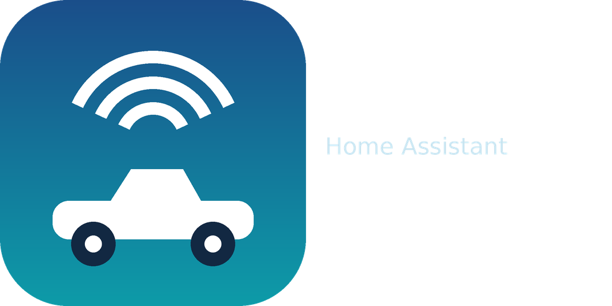

<p align="center">
  
</p>

<p align="center">
  <a href="https://my.home-assistant.io/redirect/config_flow_start/?domain=protonlink">
    
  </a>
  <a href="https://my.home-assistant.io/redirect/hacs_repository/?owner=jimmy93&repository=protonlink-ha&category=integration">
    
  </a>
  <a href="https://github.com/jimmy93/protonlink-ha/releases">
    
  </a>
  <a href="https://github.com/jimmy93/protonlink-ha/actions/workflows/validate.yml">
    
  </a>
  <a href="https://github.com/jimmy93/protonlink-ha/blob/main/LICENSE">
    
  </a>
</p>

# Proton Link for Home Assistant

A read-only Home Assistant integration for **Proton** vehicles (Malaysia) that
use the ECARX *Atlas* connected-car platform — the same app family as Proton
Link.

Once set up you get native Home Assistant entities for your car: odometer,
fuel level, last trip, vehicle state, park status and a `device_tracker` with
its last known position.

> **Read-only by design.** The integration polls telemetry. It contains no
> endpoint that can start, stop, lock, unlock or otherwise command the vehicle.

## Quick start

If you already run HACS, these two buttons do the whole job:

<p>
  <a href="https://my.home-assistant.io/redirect/hacs_repository/?owner=jimmy93&repository=protonlink-ha&category=integration">
    
  </a>
  <a href="https://my.home-assistant.io/redirect/config_flow_start/?domain=protonlink">
    
  </a>
</p>

1. **Open in HACS** (left button) → **Download** this repository → restart Home Assistant.
2. **Add integration to Home Assistant** (right button) → enter your phone number and password.

The buttons only work from a browser that can reach your Home Assistant
instance; they deep-link into your own setup rather than to GitHub.

## Installation

### HACS (recommended)

1. In Home Assistant, open **HACS → Integrations**.
2. Open the three-dot menu → **Custom repositories**.
3. Add `https://github.com/jimmy93/protonlink-ha` with category **Integration**.
4. Search for **Proton Link**, install it, and restart Home Assistant.

### Manual

Copy `custom_components/protonlink` into your Home Assistant `config/custom_components/`
directory and restart.

## Configuration

1. Go to **Settings → Devices & Services → Add Integration**.
2. Search for **Proton Link**.
3. Enter the **phone number** and **password** you use in the Proton Link app.

The phone number should be in international format without a `+`, e.g.
`60123456789`. A leading `+` or a local `0` prefix is accepted and converted
automatically.

## Entities

All entities are grouped under a single device named after your car
(e.g. `Proton X50`), so a sensor reads `Proton X50 Odometer` and the tracker
reads `Proton X50 Location`.

| Entity | Description |
| --- | --- |
| `sensor.*_odometer` | Total distance travelled (km) |
| `sensor.*_fuel_level` | Fuel level (%) |
| `sensor.*_last_trip_distance` / `_avg_speed` / `_started` / `_ended` | Most recent trip |
| `sensor.*_trips_recorded` | Trips held in the trip log |
| `sensor.*_engine_state`, `_power_mode`, `_immobilization`, `_svt_state` | Vehicle state vector |
| `sensor.*_data_remaining` / `_data_used` | Telematics data allowance (GiB) |
| `binary_sensor.*_parked` | Vehicle reports itself parked |
| `device_tracker.*_location` | Last known position (WGS-84) |

Diagnostic entities (VIN, model, registration, colour, position upload, trip
log state) are hidden by default.

### Location on a map

`device_tracker.*_location` gets its coordinates from the **last recorded
journey**, not from a live GPS feed, so the pin moves when the car reports a
new trip rather than continuously. Add it to a map card:

```yaml
type: map
entities:
  - device_tracker.proton_x50_location
```

If the car seems to be missing from the map while it is parked at home, that is
expected. Home Assistant's map merges markers that sit in the same zone into a
single bubble — the car, your phone and anyone else at home are all inside
`zone.home`, so they collapse into the one "home" bubble. Zoom in far enough and
they separate; drive the car away and its own marker appears.

Two things make the car look absent:

* **It is parked inside a zone** (usually `home`) with other tracked devices, so
  its marker is grouped into that zone's bubble.
* **No new trip has been recorded yet.** Until the car reports a journey, the
  pin stays where the previous one ended.

## How it works, and its limits

The official app reads live telemetry from `app/v1/vehicle/realtimeData`. On
many vehicles that endpoint is behind a paid "basic benefits" subscription and
answers `150001006 — the basic benefits for your car have expired`. This
integration therefore **does not use it**.

Instead it derives its values from endpoints that remain open:

* `journeyLog/logList` — the trip log, which carries odometer, fuel level and
  GPS breadcrumbs for every recorded journey.
* `journeyLog/resetEnable` — a live vehicle state vector (`engineState`,
  `powerMode`, `immobilizationState`, `positionUploadState`, …).
* `vehicle/parkingStatus`, `vehicle/flow`, `vehicle/capability/service/app`.

Consequences you should know about:

* **Values update when the car reports.** The vehicle uploads on ignition
  events and periodic check-ins, so this is not a live telemetry feed. A poll
  interval of 15–30 minutes is appropriate; shorter intervals rarely surface
  newer data.
* **Odometer and fuel come from the newest trip record**, so they reflect the
  last time the car was driven rather than an instantaneous reading.
* **The service is single-session.** Logging in elsewhere (the phone app, for
  instance) invalidates this integration's token; it will re-authenticate on
  the next poll. The app and the integration will displace one another.
* **There is no remote control**, and none is planned.

## Troubleshooting

| Symptom | Cause |
| --- | --- |
| "Incorrect phone number or password" | Check the number format and password. |
| "no Proton vehicle linked to this account" | Credentials are valid but the account has no car. |
| Entities stop updating | The app logged in elsewhere and rotated the session; it recovers on the next poll. |
| Odometer is stale | The car has not reported a new trip since it was last driven. |
| Car missing from the map | It is parked inside `zone.home` with other tracked devices, so its marker is merged into the home bubble. See *Location on a map*. |

Enable debug logging for more detail:

```yaml
logger:
  logs:
    custom_components.protonlink: debug
```

## Disclaimer

This is an unofficial integration. It is not affiliated with, endorsed by, or
supported by Proton or ECARX. It was built by observing the traffic of an
app on the author's own vehicle and account. Use it on vehicles you own. The
API is undocumented and may change without notice.
